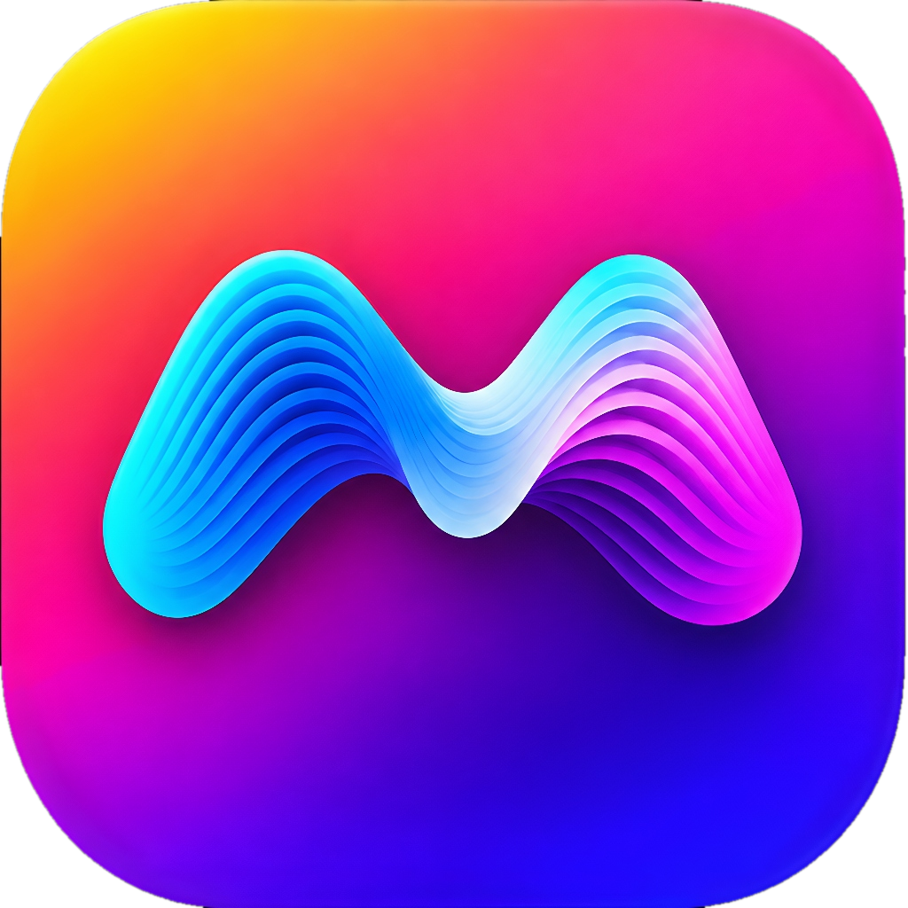
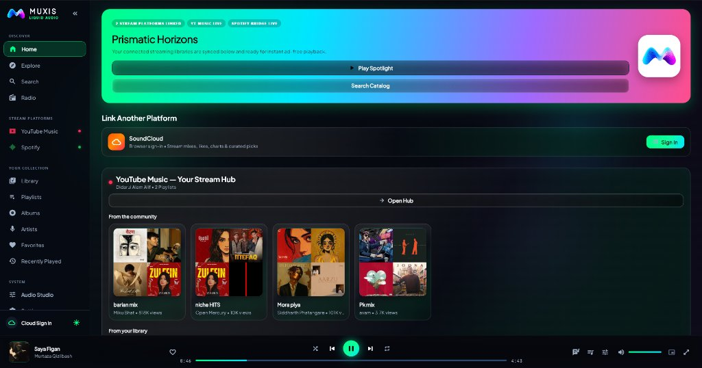
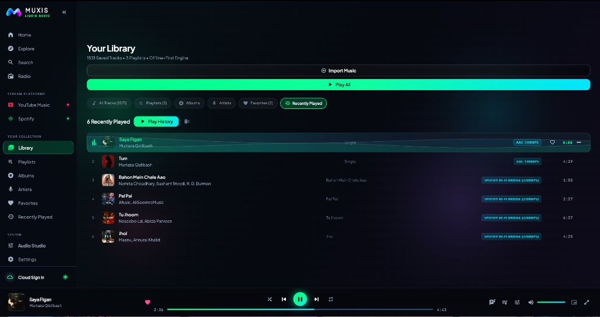
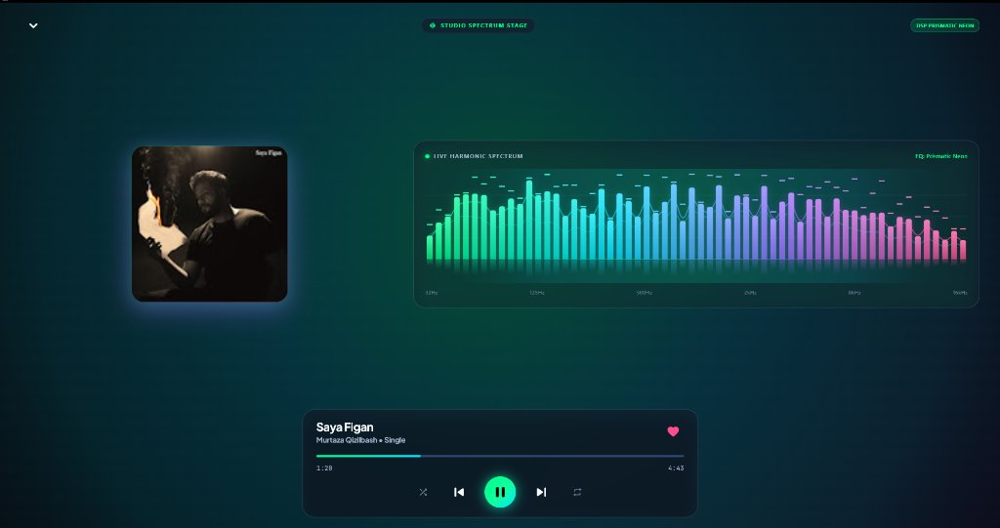
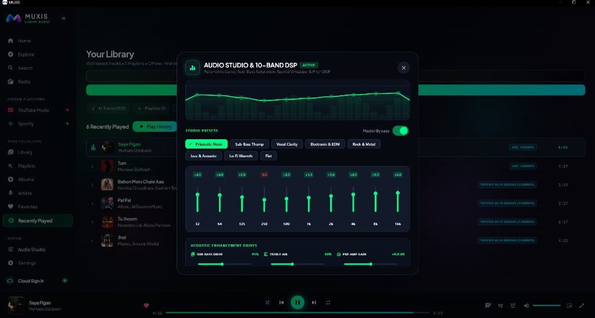
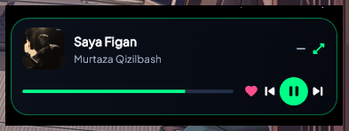
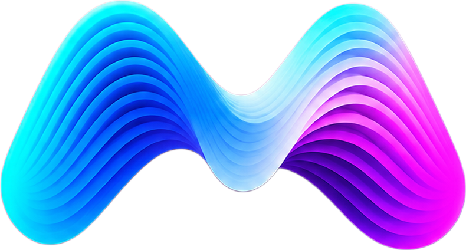

<div align="center">
  
  <h1>MUXIS — PRISMATIC AURA</h1>
  <p><strong>Cross-Platform Music Streaming, Global Radio &amp; Lossless Audio Player</strong></p>
  <p>
    <a href="https://github.com/DidarAlif/muxis/releases/latest">
      
    </a>
    <a href="#8-licensing--compliance">
      
    </a>
    
    
  </p>
  <p>
    <a href="https://didaralif.github.io/muxis/download.html">Download Installers</a> •
    <a href="https://github.com/DidarAlif/muxis/releases">All Releases</a> •
    <a href="#2-screenshots">Screenshots</a> •
    <a href="#6-building-and-running">Build from Source</a>
  </p>
</div>

---

## 1. Overview

**Muxis** is a modern, high-fidelity cross-platform music streaming, global live radio, and local lossless audio player application. Built around a liquid-glass visual design system (**Prismatic Aura**), Muxis brings your local audio collection together with **YouTube Music**, **Spotify**, **SoundCloud**, and live **Global FM / Online Radio** stations in one responsive desktop and mobile experience.

### Key Capabilities:
- **Multi-Platform Streaming Integrations:** Interactive in-app browser sign-in (`YouTube Music`, `Spotify`, and `SoundCloud`) importing personal playlists, liked songs, sets, and home featured shelves with real-time stream resolution.
- **Unified Audio Core & Virtualized Library:** Smooth playback of local files (`FLAC`, `MP3`, `WAV`, `AAC`, `M4A`, `OGG`, `OPUS`) alongside online streams, with instant sorting (`A–Z`, Artist, Duration, Source), keyword preset chips, and virtualized scrolling for multi-thousand-track libraries.
- **Prismatic Aura Liquid Glass UI:** Translucent surfaces with interactive hover wave caustics and water-drop click ripples, ambient artwork glow, desktop floating mini-player on minimize, and full-screen **Studio Spectrum Stage** harmonic visualizer.
- **Audio Studio & 10-Band Parametric DSP:** Master 10-band studio equalizer (`32 Hz` to `16 kHz`) with curated acoustic presets (`Prismatic Neon`, `Sub Bass Thump`, `Vocal Clarity`, etc.), sub-bass drive, treble air, and pitch/tempo control.
- **Global FM & Radio Tuner:** Country-based station discovery, dial frequency tuning, and instant playback backed by redundant Radio Browser mirrors.
- **In-App Self-Updater & Native Installers:** Automatic release check popup with direct in-app installer/APK download and verification against SHA-256 checksums, packaged as a standard Windows Inno Setup installer (registered in Start Menu & Installed Apps), macOS Universal `.zip`, Linux `.tar.gz`, and Android `.apk`/`.aab`.

---

## 2. Screenshots

<table>
  <tr>
    <td align="center" width="50%">
      
      <br /><sub><strong>Home &amp; Stream Hubs</strong> — Personalized shelves across YouTube Music, Spotify &amp; SoundCloud</sub>
    </td>
    <td align="center" width="50%">
      
      <br /><sub><strong>Your Library</strong> — Fast virtualized multi-source track list, keyword presets &amp; sort bar</sub>
    </td>
  </tr>
  <tr>
    <td align="center" width="50%">
      
      <br /><sub><strong>Studio Spectrum Stage</strong> — Full-screen real-time harmonic visualizer &amp; playback stage</sub>
    </td>
    <td align="center" width="50%">
      
      <br /><sub><strong>Audio Studio &amp; 10-Band DSP</strong> — Parametric EQ curve, studio presets &amp; acoustic drives</sub>
    </td>
  </tr>
</table>

<div align="center">
  
  <br /><sub><strong>Floating Desktop Mini-Player</strong> — Compact always-accessible transport controls when minimized</sub>
</div>

---

## 3. Visual Identity & Brand System

<p align="center">
  
  &nbsp;&nbsp;&nbsp;&nbsp;&nbsp;
  
</p>

### Official Color Tokens:
- **Electric Cyan:** `#00F2FE` (Primary active audio indicator and scrub thumb)
- **Prismatic Blue:** `#4FACFE` (Mid-tone frequency accent)
- **Velvet Violet:** `#7F00FF` (Harmonic secondary gradient accent)
- **Neon Magenta:** `#E100FF` (Dynamic highlights and favorite indicators)
- **Obsidian Dark Surfaces:** `#090B10` (Base background), `#111520` (Deep space), `#191F2D` (Elevated surface), `#252D40` (Hover), `#2B3448` (Border)
- **Porcelain Light Surfaces:** `#F7F8FC` (Base background), `#FFFFFF` (Card surfaces), `#EEF1F8` (Secondary), `#DCE2EF` (Border)

### Brand & Icon Assets:
- `assets/brand/muxis_mark.png` & `assets/brand/muxis_mark_square.png`: Backgroundless 3D ribbon "M" wave mark for frosted glass UI surfaces, headers, and favicons.
- `assets/brand/app_icon_1024.png` & `assets/brand/app_icon.ico`: Backgrounded squircle app icon for desktop/mobile launchers, badges, and Windows executables.
- `assets/brand/icons/`: Pre-sized Android mipmap, macOS AppIcon, and Linux PNG launcher assets used in CI builds.

---

## 4. Project Architecture

```
muxis_player/
├── assets/brand/            <-- Muxis ribbon logos, app icons, and platform icon sets
├── docs/screenshots/        <-- Application screenshots for documentation
├── installer/windows/       <-- Inno Setup script for Windows Start Menu & Installed Apps
├── lib/
│   ├── main.dart            <-- Application entry point with ProviderScope
│   ├── app/                 <-- MaterialApp, Prismatic Aura themes, GoRouter navigation
│   ├── core/
│   │   ├── audio/           <-- Audio playback engine, queue manager & 10-band DSP
│   │   ├── auth/            <-- Single-window OAuth WebView bridge (YT/Spotify/SoundCloud)
│   │   ├── database/        <-- Local indexed library, playlists, favorites & history store
│   │   ├── lyrics/          <-- LRCLIB & local synchronized .lrc parser
│   │   ├── local_scanner/   <-- Desktop/mobile audio metadata scanner
│   │   └── updates/         <-- GitHub Releases in-app self-updater & SHA-256 verifier
│   ├── features/            <-- Shell, Home, Explore, Search, Radio, Library, Player, Studio, Settings
│   ├── providers/           <-- Local, InnerTube (YT), Spotify, SoundCloud & Radio Browser providers
│   └── shared/              <-- Models, sorting/auth utils, liquid-glass & virtualized widgets
├── test/                    <-- Standalone pure-Dart unit test suite
└── pubspec.yaml
```

---

## 5. Desktop Keyboard Shortcuts

| Shortcut | Action |
| :--- | :--- |
| `Space` | Play / Pause |
| `Ctrl + Right` | Skip to Next Track |
| `Ctrl + Left` | Return to Previous Track / Beginning |
| `Ctrl + Up` | Increase Volume (+5%) |
| `Ctrl + Down` | Decrease Volume (-5%) |
| `Ctrl + K` / `Ctrl + F` | Open Command Palette & Search |
| `Ctrl + L` | Jump to Your Music Library |

---

## 6. Building and Running

### Prerequisites:
- Flutter SDK (`3.27.x` stable or `3.16.0+`)
- Visual Studio 2022 with C++ Desktop Workload (for Windows native desktop runner)

### Commands:
```bash
# 1. Install dependencies
flutter pub get

# 2. Run standalone unit tests
dart test/run_unit_tests.dart

# 3. Run Windows Desktop application
flutter run -d windows

# 4. Build release binaries
flutter build windows --release
flutter build apk --release
```

---

## 7. Cross-Platform CI/CD Pipelines

Automated GitHub Actions workflows in `.github/workflows/`:
1. `validate_pr.yml`: Code formatting, static analysis (`flutter analyze --fatal-infos`), unit tests, SQL migration linting, and TypeScript compilation.
2. `build_all_platforms.yml`: Cross-platform build matrix producing Windows x64, macOS Universal, Linux x64, Android APK/AAB, and iOS bundles.
3. `release.yml`: Triggered on version tags (`v*`), compiles optimized release binaries across platforms, builds the Windows Inno Setup installer, generates SHA-256 checksums, and publishes GitHub Releases.
4. `deploy_website.yml`: Continuous delivery of `website/` to GitHub Pages.

Deployment documentation is available in `docs/deployment/`:
- `SUPABASE_SETUP.md`, `CLOUDFLARE_SETUP.md`, `GITHUB_SECRETS.md`, `SECURITY_CHECKLIST.md`, `ESTIMATED_COSTS.md`.

---

## 8. Licensing & Compliance

- The `README` references the **GNU General Public License v3.0 (GPL-3.0)** in relation to the Android reference project (`E:\Desktop\Muxis`, which includes a GPL-3.0 `LICENSE` file). *(Note: if you intend to distribute under GPL-3.0, add a root `LICENSE` file with the GPL-3.0 text; if you built this codebase independently and want a permissive license like MIT/Apache-2.0 or proprietary licensing, update this section accordingly.)*
- No private API credentials or proprietary keys are bundled. All configuration is loaded from `.env` or `--dart-define`.
